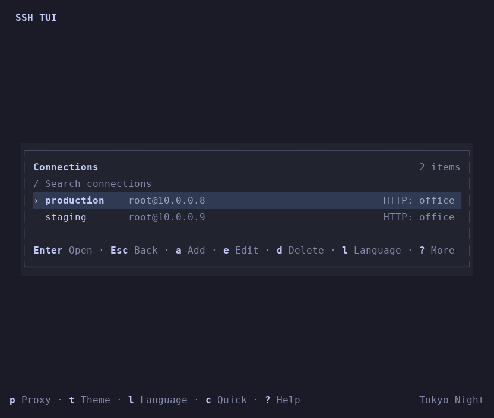
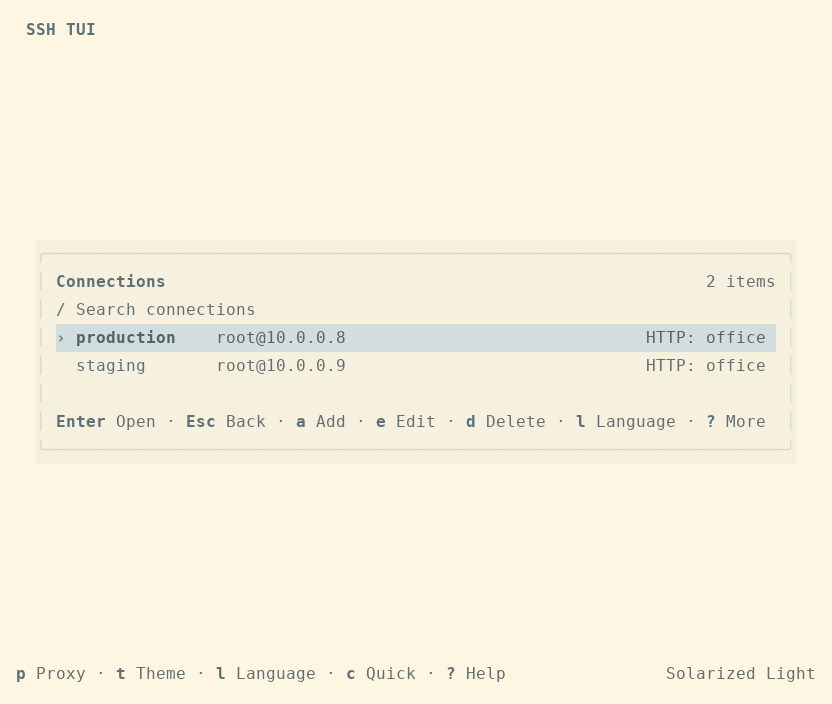

# SSH TUI

A Rust SSH connection manager for Linux and macOS with a compact terminal interface, multiple session tabs, control-key forwarding, and HTTP CONNECT proxy support. SSH transport, authentication, and host-key verification use the system OpenSSH client.

- Saved connection profiles, OpenSSH aliases, and temporary quick connections.
- Independent terminal tabs with in-memory scrollback and manual reconnection.
- Remote keyboard forwarding, including Ctrl+C, Ctrl+D, and full-screen terminal applications.
- Twelve built-in color themes, live previews, and custom TOML themes.
- HTTP/1.1 CONNECT proxies with optional Basic authentication and per-connection routing.
- Content-sized panels, aligned lists, responsive forms, and scrollable help and error details.

The interface supports English and Chinese, with English as the default.

## Interface previews

| Dark theme | Light theme |
| --- | --- |
|  |  |

The remote terminal reserves one row for tabs and one for status. Lists show up to ten entries at a time, and narrow windows use stacked form fields. See the [UI design notes](docs/ui-design.md) for layout and theme details; that document is in Chinese.

## Install with one command

Install the latest stable release on Linux x64, macOS Intel, or macOS Apple Silicon:

```bash
curl -fsSL https://raw.githubusercontent.com/ShaohongDong/ssh-tui/master/scripts/install.sh | sh
```

The installer downloads the matching GitHub Release, verifies its SHA-256 against
that release's `SHA256SUMS`, checks the executable's version, and installs it as
`~/.local/bin/ssh-tui`. It requires `curl`, `tar`, system OpenSSH, and either
`sha256sum` (Linux) or `shasum` (macOS). Standard system utilities are also required;
Rust and administrator privileges are unnecessary for the default installation.
The runtime requirements listed below still apply.

If the installation directory is missing from `PATH`, follow the printed
`export PATH=...` command and add it to your shell startup file for future
terminals. Then run `ssh-tui` from an interactive terminal.

Choose a version or another installation directory:

```bash
curl -fsSL https://raw.githubusercontent.com/ShaohongDong/ssh-tui/master/scripts/install.sh | sh -s -- --version v0.1.3
curl -fsSL https://raw.githubusercontent.com/ShaohongDong/ssh-tui/master/scripts/install.sh | sh -s -- --install-dir "$HOME/bin"

# From a repository checkout:
sh scripts/install.sh --help
sh scripts/install.sh
```

Versions accept an optional `v` prefix; specify a prerelease explicitly to install
it. Run the installer again to upgrade. Replacement is atomic, and a failed
download, checksum, or execution check preserves the existing executable. The
script leaves shell startup files and SSH configuration unchanged. To uninstall
the default installation, run `rm "$HOME/.local/bin/ssh-tui"`.

## Downloads and automated builds

Successful version-tag builds publish executables on [GitHub Releases](https://github.com/ShaohongDong/ssh-tui/releases). Choose the archive for your operating system and CPU:

| Platform | Archive |
| --- | --- |
| Linux x64 | `ssh-tui-<version>-x86_64-unknown-linux-gnu.tar.gz` |
| macOS Intel | `ssh-tui-<version>-x86_64-apple-darwin.tar.gz` |
| macOS Apple Silicon | `ssh-tui-<version>-aarch64-apple-darwin.tar.gz` |

Linux packages are built on Ubuntu 22.04 and require glibc 2.35 or newer and the system C runtime libraries. macOS packages use a deployment target of macOS 13.0; native CI acceptance runs on macOS 15, so older macOS versions have not been tested. All packages require an OpenSSH client on `PATH` and an interactive terminal. Windows binaries are not provided.

Download your archive and `SHA256SUMS` from the same release. Verify and extract it, substituting the actual version and target:

```bash
# Linux:
sha256sum --ignore-missing --check SHA256SUMS
# macOS (missing archives for other platforms are ignored):
shasum -a 256 --ignore-missing --check SHA256SUMS

tar -xzf ssh-tui-<version>-<target>.tar.gz
cd ssh-tui-<version>-<target>
./ssh-tui --version
./ssh-tui
```

The archives preserve executable permissions and include README, license, example configuration and themes, and documentation. Prebuilt macOS executables are not signed or notarized; macOS may require you to approve a downloaded executable in Privacy & Security before its first launch.

[Build and release](https://github.com/ShaohongDong/ssh-tui/actions/workflows/build.yml) runs on branch pushes, pull requests, version tags, and manual dispatch. Each native target runs Rust checks, both English and Chinese interactive acceptance suites, a release build, and an extracted-binary smoke check. Download the `packages-<target>` artifact for the archive and its individual SHA-256 file. Acceptance reports and logs are available as `acceptance-<target>` artifacts. Actions artifacts are retained for 30 days; version releases remain available separately.

To publish a version, update the package version in `Cargo.toml` and `Cargo.lock`, commit the changes, then push the matching `v<version>` tag. For example, the current version requires `v0.1.3`. Tags that differ from the package version fail before building. Only a successful tag-push run publishes a Release; a manual run produces Actions artifacts. All three targets must pass before publication. Prerelease tags such as `v0.2.0-rc.1` produce a prerelease. Rerunning a successful tag workflow replaces same-named assets on the existing Release.

## Build and run

Requirements:

- Linux or macOS.
- Rust 1.88 or newer and Cargo to build from source.
- An OpenSSH client (`ssh`) available on `PATH`.
- An interactive terminal for both standard input and standard output. True-color support is recommended for theme rendering.

From the repository root:

```bash
cargo build --release --locked
./target/release/ssh-tui
```

In the connection manager, press `a` to add a saved profile or `c` to open a temporary quick connection. Select a profile and press Enter to connect. Host fields accept aliases from `~/.ssh/config`; OpenSSH resolves `Host`, `Include`, `Match`, identities, agent authentication, and jump-host settings. SSH TUI does not edit your OpenSSH configuration.

### Saved SSH usernames and passwords

Saved profiles retain the **Username** field. To remember an SSH password, add or edit
a profile, enter the masked **SSH password**, move to **Save password**, and press
Space to turn it on before submitting. Linux stores passwords in an unlocked
Secret Service keyring (such as GNOME Keyring); macOS uses the user Keychain.
The configuration stores only an opaque `credential_id`, never the password.
An unavailable keyring causes a save error and keeps the form open.

When editing, an empty password field preserves the existing saved password.
Enter a replacement to update it, or turn **Save password** off to remove it.
Changing the host, username, or port requires entering the password again or
removing it. Renaming a profile keeps its password; deleting the profile removes
its vault entry. Failed vault cleanup is recorded as `pending_credential_cleanup`
and retried when settings are next saved. Esc discards all form changes.

Saved passwords are used for ordinary SSH password authentication over direct
and HTTP CONNECT connections, including reconnects. They are tried once per
connection; a rejected password, missing entry, or unavailable keyring produces
a message and a hidden manual password prompt. Manual input does not replace the
saved password. Host-key confirmation still requires your approval, and changed
host keys remain rejected. Passwords are not supplied as process arguments,
environment variables, temporary file contents, or terminal output.

SSH jump hosts and custom OpenSSH `ProxyCommand` routes use manual authentication.
Private-key passphrases are entered manually. Saved-password sessions exclude
keyboard-interactive challenges, including MFA; press **m** on a selected profile
or a disconnected tab for one connection using the original OpenSSH authentication
settings without the saved password. **r** reconnects using the saved settings.
Quick connections and HTTP proxy passwords are not saved. Linux headless sessions
need an accessible, unlocked Secret Service to save passwords; manual login works
without it. SSH password input is limited to 1–1023 UTF-8 bytes without CR, LF, or NUL.

Connect immediately from the command line:

```bash
# These connections are not saved as profiles.
./target/release/ssh-tui user@example.org --port 22
./target/release/ssh-tui my-ssh-alias --identity ~/.ssh/id_ed25519

# HTTP CONNECT proxy; the username is separate from the URL.
./target/release/ssh-tui my-ssh-alias --proxy http://127.0.0.1:7890
./target/release/ssh-tui my-ssh-alias --proxy http://proxy.example.org:8080 --proxy-user alice
./target/release/ssh-tui my-ssh-alias --no-proxy

# Choose a temporary language, theme, or a different configuration file.
./target/release/ssh-tui --language zh
./target/release/ssh-tui --language en
./target/release/ssh-tui --theme 'Solarized Light'
./target/release/ssh-tui --config ./examples/config.toml

./target/release/ssh-tui --help
./target/release/ssh-tui --version
```

`--port` (`-p`) and `--identity` (`-i`) require a target. `--proxy-user` requires `--proxy`, and `--proxy` conflicts with `--no-proxy`. Command-line theme and proxy overrides last for the current run. Saving unrelated settings does not persist those overrides; pressing Enter in the theme picker explicitly saves the selected theme.

Cargo produces `target/release/ssh-tui`. The ignored `dist/` directory is used for local distribution artifacts and is not included in a clone or created by the build command above. GitHub Actions builds with an explicit target, so its executables are under `target/<target>/release/ssh-tui`.

To package a local native build with the same archive layout and verification as CI:

```bash
# Use x86_64-apple-darwin or aarch64-apple-darwin on the corresponding Mac.
python3 scripts/package_release.py package \
  --binary target/release/ssh-tui \
  --target x86_64-unknown-linux-gnu --output dist/packages
```

Packaging requires Python 3.11 or newer. It verifies the binary format, CPU architecture, CLI version, and permissions, then extracts the archive and runs the executable again. Both the archive and an adjacent `.sha256` file are generated.

## Keyboard controls

When the remote terminal has focus, Ctrl+C, Ctrl+D, Ctrl+Z, Ctrl+L, Tab, Esc, arrow keys, Home/End, PageUp/PageDown, Insert/Delete, and F1–F12 are forwarded to the remote session. Ctrl+C interrupts the remote program; Ctrl+D sends the EOF control byte. When SSH exits, the tab keeps its terminal contents. Press `r` in that tab to reconnect.

### Local command prefix

Press **Ctrl+]**, release it, then press a command key:

| Command key | Action |
| --- | --- |
| `c` | Open the connection manager |
| `n` / `p` | Next / previous tab |
| `1`–`9` | Select one of the first nine tabs |
| `t` | Open the theme picker with live previews |
| `l` | Open the language picker |
| `[` | Browse scrollback |
| `x` | Close the current tab |
| `q` | Quit |
| `!` | Show full status or error details |
| `?` | Show shortcut help |
| Ctrl+] again | Send one literal Ctrl+] to the remote session |
| Esc | Cancel the pending prefix |

Unknown prefix combinations forward both the prefix and the following key. Pasted text does not trigger local commands. In scrollback mode, use arrows or `j`/`k`, PageUp/PageDown, and Home/End; Esc returns to the live terminal. Each tab keeps 10,000 scrollback lines by default. SSH TUI does not write input, output, or password logs.

### Local views

| View | Controls |
| --- | --- |
| Connection manager | Up/Down or `j`/`k` to select; Enter to connect; `a`/`e`/`d` to add/edit/delete; `c` for a temporary quick connection; `/` to search; `p` for proxies; `t` for themes; `l` for language; Tab/Esc to return to the terminal; `q` to quit |
| Proxy manager | Up/Down or `j`/`k` to select; `a`/`e`/`d` to add/edit/delete; Enter to set the global default; `0` to disable the default; `l` for language; Esc to return to the connection manager |
| Forms | Tab, Shift+Tab, or Up/Down to change fields; Left/Right and Home/End to move the cursor; Ctrl+U to clear a field; Enter to submit; Esc to cancel |
| Language picker | Up/Down or `j`/`k` to preview; Enter to save; Esc to restore the previous language and return |
| Theme picker | Up/Down or `j`/`k` to preview; PageUp/PageDown to move by the visible list height; Home/End for first/last; Enter to save; Esc to restore the previous theme |
| Help and details | Up/Down or `j`/`k`, PageUp/PageDown, and Home/End to scroll; Esc or Enter to return to the previous view |
| Confirmation | `y`/`Y` to confirm; `n`/`N` or Esc to cancel |

Saved-profile forms persist on submission; quick-connection forms only start a session. Closing a running tab, quitting with running sessions, and deleting saved configuration entries require confirmation.

Press `?` for help or `!` for details in the connection and proxy managers. F2 opens details in local views other than help and details themselves. In the remote terminal, use `Ctrl+] !`; F2 remains a remote key. Save notices disappear after about three seconds. Errors remain until the next operation, and details expose messages that do not fit the status row. A running SSH process in the status bar indicates that the local process is alive; use the remote terminal output to determine whether authentication succeeded.

Your outer terminal must deliver the keys to SSH TUI. Traditional terminal protocols cannot distinguish Ctrl+] from Ctrl+5, Tab from Ctrl+I, or Esc from Ctrl+[. Keys intercepted by the outer terminal cannot be forwarded. Paste using your terminal's paste command.

## HTTP proxy support

Open the proxy manager with `p` from the connection manager. Proxy URLs accept DNS names, IPv4 addresses, and bracketed IPv6 addresses, such as `http://proxy.example.org:8080` or `http://[::1]:7890`. The default HTTP port is 80. Do not include credentials, a non-root path, a query, or a fragment in the URL.

The proxy transport uses **HTTP/1.1 CONNECT**. HTTPS proxy transport and HTTP/2 are not supported. The proxy must allow CONNECT to the target SSH port, and the target hostname is resolved by the proxy.

Leave the proxy username empty for an unauthenticated proxy. With a username, the session prompts for a Basic-authentication password without echoing it. The password is not stored in the application configuration, command-line arguments, environment variables, or logs. Plain HTTP does not encrypt Basic credentials between the client and proxy. The tunneled SSH session remains encrypted and uses OpenSSH host-key verification.

### Routing precedence

The connection form's proxy field accepts:

| Form value | TOML route | Behavior |
| --- | --- | --- |
| Empty or `inherit` | `{ mode = "inherit" }` | Use a command-line proxy override, otherwise the global default proxy; without either, use OpenSSH routing |
| `direct` | `{ mode = "direct" }` | Disable the application's HTTP proxy and use OpenSSH routing |
| A saved proxy name | `{ mode = "http", name = "local" }` | Use that proxy for this connection |

`--proxy` and `--no-proxy` affect inherited routes only. A profile with an explicit HTTP proxy or `direct` route keeps its own setting. `direct` and `--no-proxy` still allow `ProxyJump` or `ProxyCommand` from the effective OpenSSH configuration.

An application HTTP proxy cannot be combined with an SSH jump host. Before an HTTP-proxy connection, SSH TUI checks the effective OpenSSH configuration for `ProxyJump` and `ProxyCommand`; a conflict stops the connection. Use an alias without that route when selecting an HTTP proxy. A proxy failure never falls back to a direct connection.

Proxy DNS/TCP connection and CONNECT handshake budgets are 15 seconds each. A 407 response indicates an authentication failure; 403 indicates that the proxy denied the target. Read the session output or full error details, correct the settings, and reconnect. OpenSSH sessions use a 30-second server-alive interval and disconnect after three unanswered probes.

## Interface language

English (`en`) and Chinese (`zh`) are available. The precedence is `--language` > the saved `language` setting > English. Existing configuration files without a language setting also use English; the system locale does not select the interface language.

Press `l` in the connection or proxy manager, or `Ctrl+] l` in a remote terminal, to open the language picker. The choices are shown as `English` and `中文`. Up/Down previews the language immediately, Enter saves it, and Esc restores the previous language. Both save and cancel return to the view that opened the picker. A save failure keeps the picker open and leaves the saved configuration unchanged.

`--language en` or `--language zh` is temporary. Saving other settings does not persist that override; Enter in the language picker explicitly saves the selected language. Language changes update application labels and status without reconnecting active SSH sessions. Plain `l` is still forwarded when the remote terminal has focus.

Application menus, help, confirmations, notices, status, validation errors, and proxy password prompts are translated. User data, theme names, OpenSSH and remote output, and raw system/library diagnostics remain unchanged. The proxy helper uses the language selected when a connection starts; existing terminal contents are not rewritten, and reconnecting uses the current language. CLI help is always in English. Before configuration has loaded, application errors use an explicit CLI language override or English.

## Configuration

The default configuration file is `$XDG_CONFIG_HOME/ssh-tui/config.toml`, or `~/.config/ssh-tui/config.toml` when `XDG_CONFIG_HOME` is unset or empty. Use `--config PATH` to select another file.

A missing file starts with defaults. Saving settings creates the file using an atomic replacement with permissions `0600`. Invalid configuration is reported without overwriting the original file. Passwords are not part of the configuration format.

Example configuration:

```toml
language = "en"
theme = "Ubuntu 22.04"
scrollback = 10000
default_proxy = "local"

[[proxies]]
name = "local"
url = "http://127.0.0.1:7890"
username = ""

[[connections]]
name = "work-server"
host = "my-ssh-alias"
user = ""
identity = ""
jump = ""
route = { mode = "inherit" }
```

Omit `port` to use OpenSSH's effective port, or add `port = 2222` to override it. Empty `user` and `identity` fields leave those choices to OpenSSH. The `jump` field accepts comma-separated hops and `user@host:port` syntax; bracket IPv6 addresses when specifying a port. Scrollback can be configured up to 100,000 lines per tab.

Connection names must be unique, and proxy names must be unique. Renaming a proxy updates its references. Before deleting a proxy explicitly referenced by a connection, change that connection's route. See [examples/config.toml](examples/config.toml) for inherited, direct, and explicit HTTP-proxy profiles.

## Color themes

Built-in themes:

- Tokyo Night
- Dracula
- Nord
- Gruvbox Dark
- Solarized Dark
- Solarized Light
- [Catppuccin Mocha](https://github.com/catppuccin/kitty/blob/main/themes/mocha.conf)
- [One Dark](https://github.com/atom/one-dark-syntax/blob/master/styles/colors.less) (Atom palette mapped to ANSI roles)
- [Monokai](https://github.com/microsoft/vscode/blob/main/extensions/theme-monokai/themes/monokai-color-theme.json)
- [Kanagawa](https://github.com/rebelot/kanagawa.nvim/blob/master/lua/kanagawa/themes.lua) (Wave)
- [Everforest Dark](https://github.com/sainnhe/everforest/blob/master/autoload/everforest.vim) (Medium)
- [Rose Pine](https://github.com/rose-pine/kitty/blob/main/dist/rose-pine.conf)
- Ubuntu 22.04 (default; black background, white text, and ANSI colors captured from a local GNOME Terminal profile; Ubuntu orange UI accent)

One theme controls both the application UI and terminal colors. Default foreground/background and ANSI colors 0–15 follow the theme; explicit indexed colors 16–255 and RGB colors retain the remote application's choices. The picker previews a shell prompt, a CJK directory name, errors, selected rows, and ANSI colors. Wide windows show the preview beside the theme list; narrow windows stack them.

Press `t` in the connection manager, or `Ctrl+] t` in a remote terminal, to choose a theme. The heading shows the selected position and total, including custom themes (for example, `7/13`). PageUp/PageDown moves by the number of visible list rows and stops at the ends; Home/End jumps to the first/last theme. Up/Down and `j`/`k` cycle through the list. Selection previews immediately without reconnecting SSH sessions. Enter saves the selection, and Esc restores the theme used when the picker opened. If saving fails, the picker and preview remain open and the saved configuration stays unchanged.

Start with the Ubuntu theme using `ssh-tui --theme "Ubuntu 22.04"`, or save `theme = "Ubuntu 22.04"` in the configuration. This theme matches the captured local profile, including its customized ANSI blue; it does not claim to reproduce every Ubuntu installation's defaults.

### Custom themes

Place custom `*.toml` files in a `themes/` directory beside the selected configuration file, then restart. For the default configuration, this is `$XDG_CONFIG_HOME/ssh-tui/themes/` or `~/.config/ssh-tui/themes/`. Theme names must be unique across built-in and custom themes.

Each theme defines `name`, `foreground`, `background`, `accent`, `muted`, and a `palette` of exactly 16 `#RRGGBB` colors. See the complete [Amber theme example](examples/themes/amber.toml). Try the repository's bundled example with:

```bash
./target/release/ssh-tui --config ./examples/config.toml --theme Amber
```

The following UI roles are optional. Append them to a complete theme file to override derived defaults; themes without this section remain supported.

```toml
[ui]
surface = "#242633"
border = "#414868"
selection_background = "#303a55"
selection_foreground = "#c0caf5"
success = "#9ece6a"
attention = "#e0af68"
failure = "#f7768e"
```

Application text colors are adjusted to at least 4.5:1 contrast against their actual UI backgrounds, while borders remain subdued. This adjustment applies to UI text; terminal theme colors and remote explicit colors follow the rules above.

## Development and validation

Run the Rust checks from the repository root:

```bash
cargo fmt --check
cargo clippy --locked --all-targets -- -D warnings
cargo test --locked
cargo build --release --locked
sh -n scripts/install.sh
python3 -m unittest discover -s tests -p 'test_*.py' -v
```

Python unit tests cover release packaging and installation using isolated
downloads, temporary destinations, and simulated platforms. CI also installs
and reinstalls its actual native package on all three targets. To run that check
locally, point `SSH_TUI_INSTALL_TEST_PACKAGES` at a directory containing only the
current platform's archive and its adjacent `.sha256` file:

```bash
SSH_TUI_INSTALL_TEST_PACKAGES=dist/packages python3 -m unittest discover -s tests -p 'test_install.py' -v
```

Interactive acceptance tests run on Linux and macOS. They require Python 3.11 or newer, the dependencies in [tests/requirements.txt](tests/requirements.txt), and local `ssh`, Bash, `top`, `less`, `vi`, `ps`, `stty`, and `seq` commands. Install the Python dependencies in a virtual environment:

```bash
python3 -m venv --system-site-packages .venv
.venv/bin/pip install -r tests/requirements.txt
.venv/bin/python tests/e2e.py --binary target/release/ssh-tui --language en --output target/e2e-en
.venv/bin/python tests/e2e.py --binary target/release/ssh-tui --language zh --output target/e2e-zh
```

On macOS, install modern Bash with `brew install bash` and put `$(brew --prefix bash)/bin` first on `PATH` before running acceptance. The fixture uses Bash's bracketed-paste support; the older system Bash is insufficient for that test. Running SSH TUI itself does not require Homebrew or Bash.

The script uses loopback SSH and HTTP-proxy fixtures, temporary keys, isolated SSH configuration, and separate `known_hosts` files. It does not use personal credentials or connect to real servers. Reports include the platform, architecture, language, and completed scenarios. Reports and terminal text snapshots are written to `target/e2e/` by default; use `--output PATH` to choose another directory. CI saves each run's output in `run.log` for failure diagnosis.

UI golden snapshots cover both languages at 80×24, 120×36, 48×12, and 24×6 and are stored in [tests/snapshots](tests/snapshots). Recorded local acceptance results are available in [docs/validation.md](docs/validation.md) (Chinese) and the [machine-readable report](docs/e2e-release.json). Local fixture results do not establish compatibility with every production SSH server, enterprise proxy, or outer terminal.

## Current limitations

This version supports Linux and macOS and depends on the system `ssh` command. It does not include HTTPS/HTTP2 proxy transport, SOCKS, NTLM/Kerberos proxy authentication, combined HTTP-proxy and SSH-jump routing, split panes, SFTP, a port-forwarding management UI, mouse interaction, or system clipboard integration.

## License

[MIT](LICENSE).

Native password acceptance also needs `dbus-run-session`, `dbus-send`, and
`gnome-keyring-daemon` on Linux. It creates a private D-Bus session and disposable
keyring. On macOS it creates a temporary Keychain, temporarily selects it as the
user default, and restores the previous default in `finally`; run it in a
controlled development or CI session. Both runners use only fixture passwords.

```bash
.venv/bin/python tests/e2e_credentials.py --binary target/release/ssh-tui --language en --output target/e2e-credentials-en
.venv/bin/python tests/e2e_credentials.py --binary target/release/ssh-tui --language zh --output target/e2e-credentials-zh
```

The ignored `system_credentials` Rust test additionally checks native vault
create/read/replace/delete; pass its compiled test executable with `--native-test`
to run it inside the same disposable vault, as CI does.
